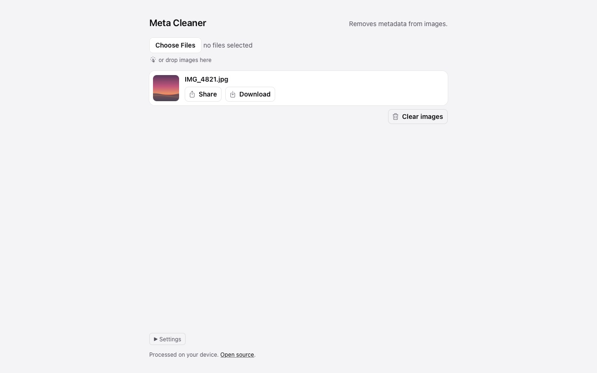
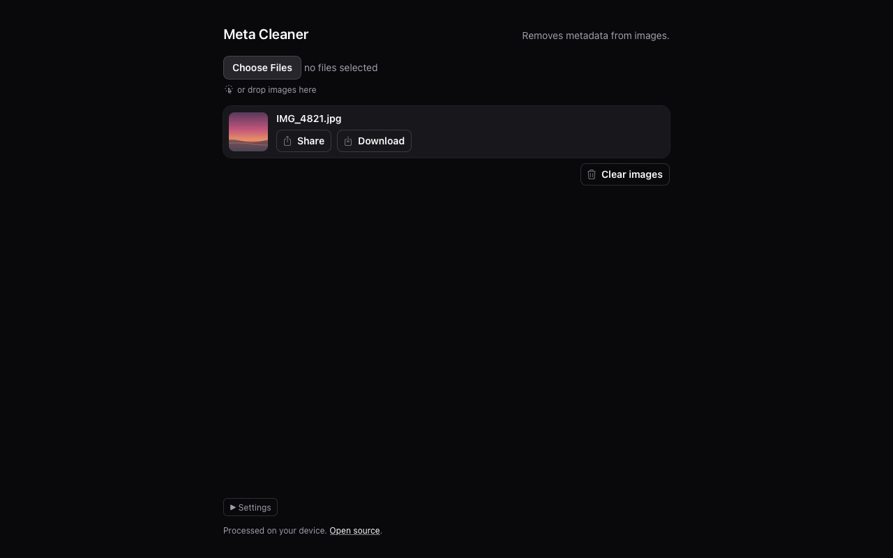

<div align="center">

# Meta Cleaner

**Removes metadata from images in the browser.** Drop a photo, get it back without EXIF, GPS, XMP, IPTC, comments and the rest.<br>
Nothing is uploaded, pixels are never re-encoded.

### [▶ Open meta.avolkov.dev](https://meta.avolkov.dev)

Best in Safari: Share hands the cleaned photo straight to Messages, Mail or Photos. Works offline once added to the Home Screen on iPhone, iPad or Mac.

<!-- Happy-path video: drag /private/tmp/claude-501/-Users-alex-Downloads-github/eba4b07d-fb10-47d6-8ce4-42740ad111e8/scratchpad/media/MetaCleaner/happy-path.mp4 onto this line in the GitHub editor -->

 

</div>

## How it works

JPEG, PNG, WebP, GIF, HEIC, TIFF and SVG are cleaned byte by byte: the blocks that carry metadata are dropped and the image data is copied as it is, so the pixels never change. The Orientation tag and the ICC colour profile can be kept (Settings). Anything else is re-encoded through a canvas.

Every cleaned file is checked by [ExifTool](https://exiftool.org), the standard tool for image metadata: the tests run the real ExifTool over the output for each format and fail if any personal tag survives.

## Run it locally

Needs Node 24 or newer. `npm test` needs ExifTool (`brew install exiftool`).

```sh
git clone --depth 1 https://github.com/slimcandy/MetaCleaner.git
cd MetaCleaner
npm install
npm run build && npm start   # http://127.0.0.1:4173/
```
