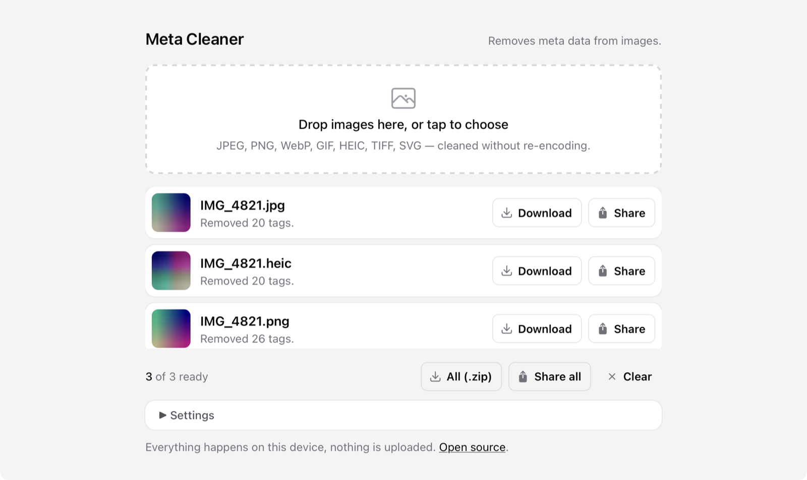

# Meta Cleaner

Removes metadata from images in the browser. Nothing is uploaded.

<https://meta.avolkov.dev>



Drop a photo, get it back without EXIF, GPS, XMP, IPTC, comments and the rest. JPEG, PNG, WebP, GIF, HEIC, TIFF and SVG are cleaned byte by byte, the pixels are never re-encoded. Works offline once installed as a PWA on iPhone, iPad or Mac.

## Run it yourself

```sh
git clone https://github.com/slimcandy/MetaCleaner.git
cd MetaCleaner
npm install
npm run dev
```

`npm run build` puts a static site into `dist/`. Tests compare every cleaned file against the real [ExifTool](https://exiftool.org), so `npm test` needs it installed (`brew install exiftool`).
